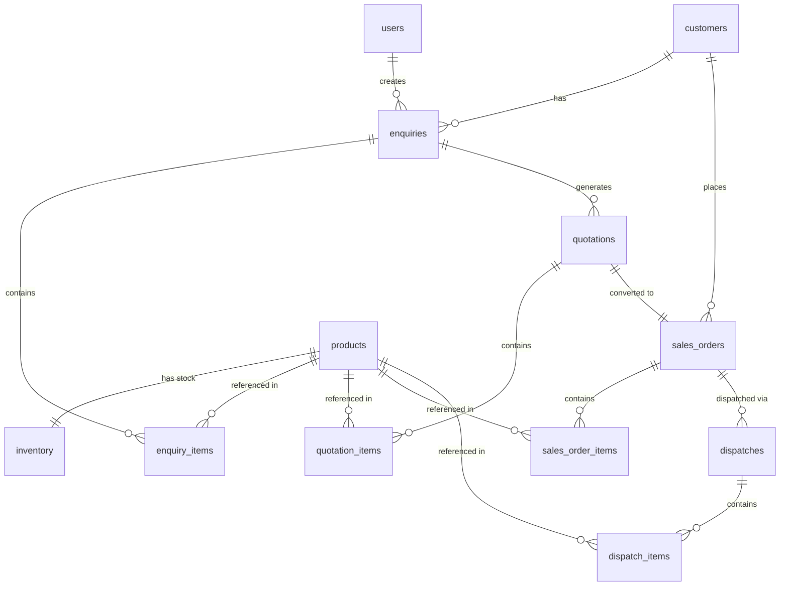

# PostgreSQL Database Schema & ER Diagram

## Overview
This document describes the relational database schema designed for the PERN ERP technical case study. The schema enforces data consistency, integrity, unique constraints, and foreign key relationships across all core business entities.

---

## Entity Relationship (ER) Diagram

---

## Table Structure & Relationships

### 1. `users`
Stores system accounts for authentication and RBAC.
- `id` (INT, Primary Key)
- `name` (VARCHAR, Not Null)
- `email` (VARCHAR, Unique, Not Null)
- `password_hash` (VARCHAR, Not Null) - Hashed using `bcryptjs`
- `role` (VARCHAR, Not Null) - Restricted via `CHECK (role IN ('ADMIN', 'SALES_USER'))`
- `created_at` (TIMESTAMP)

### 2. `customers`
Stores client company details.
- `id` (INT, Primary Key)
- `company_name` (VARCHAR, Not Null)
- `contact_person` (VARCHAR, Not Null)
- `mobile` (VARCHAR, Not Null)
- `email` (VARCHAR)
- `city` (VARCHAR, Not Null)
- `created_at` (TIMESTAMP)

### 3. `products`
Master catalog of industrial items.
- `id` (INT, Primary Key)
- `product_code` (VARCHAR, Unique, Not Null)
- `product_name` (VARCHAR, Not Null)
- `category` (VARCHAR, Not Null)
- `unit` (VARCHAR, Not Null)
- `base_price` (NUMERIC(12,2), Not Null, `CHECK >= 0`)
- `created_at` (TIMESTAMP)

### 4. `inventory`
Tracks physical and reserved quantities per product.
- `id` (INT, Primary Key)
- `product_id` (INT, Foreign Key -> `products(id)`, Unique, On Delete Cascade)
- `physical_quantity` (INT, Not Null, `CHECK >= 0`)
- `reserved_quantity` (INT, Not Null, `CHECK >= 0`)
- **Constraint**: `CHECK (reserved_quantity <= physical_quantity)`
- **Computed Metric**: `Available Quantity = Physical Quantity - Reserved Quantity`

### 5. `enquiries`
Captures customer requests for products.
- `id` (INT, Primary Key)
- `enquiry_number` (VARCHAR, Unique, Not Null)
- `customer_id` (INT, Foreign Key -> `customers(id)`)
- `enquiry_date` (DATE, Default Current Date)
- `required_date` (DATE)
- `notes` (TEXT)
- `status` (VARCHAR, Default 'NEW', `CHECK IN ('NEW', 'QUOTED', 'WON', 'LOST')`)
- `created_by` (INT, Foreign Key -> `users(id)`)

### 6. `enquiry_items`
Junction table for multiple products per enquiry.
- `id` (INT, Primary Key)
- `enquiry_id` (INT, Foreign Key -> `enquiries(id)`, On Delete Cascade)
- `product_id` (INT, Foreign Key -> `products(id)`)
- `quantity` (INT, Not Null, `CHECK > 0`)

### 7. `quotations`
Calculated price quotations against enquiries.
- `id` (INT, Primary Key)
- `quotation_number` (VARCHAR, Unique, Not Null)
- `enquiry_id` (INT, Foreign Key -> `enquiries(id)`)
- `quotation_date` (DATE, Default Current Date)
- `valid_until` (DATE)
- `status` (VARCHAR, Default 'DRAFT', `CHECK IN ('DRAFT', 'SENT', 'ACCEPTED', 'REJECTED')`)

### 8. `quotation_items`
Line items for quotations including discount and tax calculations.
- `id` (INT, Primary Key)
- `quotation_id` (INT, Foreign Key -> `quotations(id)`, On Delete Cascade)
- `product_id` (INT, Foreign Key -> `products(id)`)
- `quantity` (INT, Not Null, `CHECK > 0`)
- `unit_price` (NUMERIC(12,2), Not Null, `CHECK >= 0`)
- `discount_percent` (NUMERIC(5,2), Default 0, `CHECK between 0 and 100`)
- `gst_percent` (NUMERIC(5,2), Default 0, `CHECK between 0 and 100`)

### 9. `sales_orders`
Confirmed business sales orders generated from accepted quotations.
- `id` (INT, Primary Key)
- `order_number` (VARCHAR, Unique, Not Null)
- `quotation_id` (INT, Foreign Key -> `quotations(id)`, Unique, On Delete Restrict) — *Guarantees 1-to-1 conversion and prevents duplicate order creation*
- `customer_id` (INT, Foreign Key -> `customers(id)`)
- `order_date` (DATE, Default Current Date)
- `total_amount` (NUMERIC(12,2), Not Null, `CHECK >= 0`)
- `status` (VARCHAR, Default 'PENDING', `CHECK IN ('PENDING', 'CONFIRMED', 'DISPATCHED', 'CANCELLED')`)

### 10. `sales_order_items`
Items snapshot for a confirmed Sales Order.
- `id` (INT, Primary Key)
- `sales_order_id` (INT, Foreign Key -> `sales_orders(id)`, On Delete Cascade)
- `product_id` (INT, Foreign Key -> `products(id)`)
- `quantity` (INT, Not Null, `CHECK > 0`)
- `unit_price` (NUMERIC(12,2), Not Null, `CHECK >= 0`)

### 11. `dispatches`
Dispatched order shipments.
- `id` (INT, Primary Key)
- `dispatch_number` (VARCHAR, Unique, Not Null)
- `sales_order_id` (INT, Foreign Key -> `sales_orders(id)`)
- `dispatch_date` (DATE, Default Current Date)
- `vehicle_number` (VARCHAR, Not Null)
- `driver_name` (VARCHAR, Not Null)

### 12. `dispatch_items`
Items dispatched per shipment.
- `id` (INT, Primary Key)
- `dispatch_id` (INT, Foreign Key -> `dispatches(id)`, On Delete Cascade)
- `product_id` (INT, Foreign Key -> `products(id)`)
- `quantity` (INT, Not Null, `CHECK > 0`)
